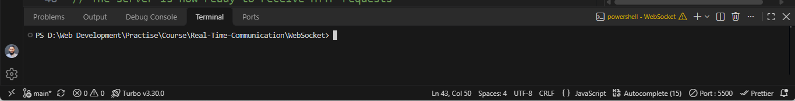
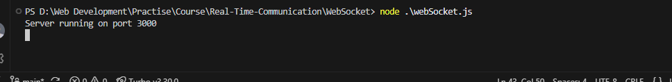
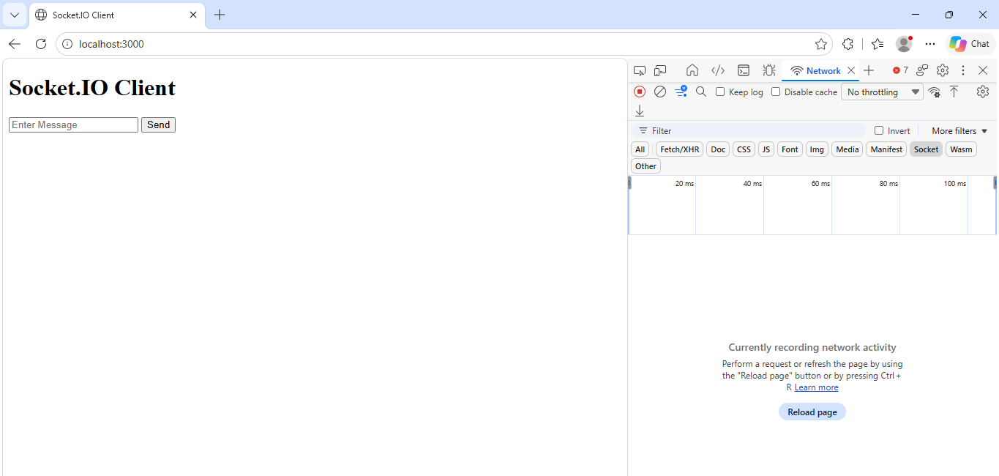
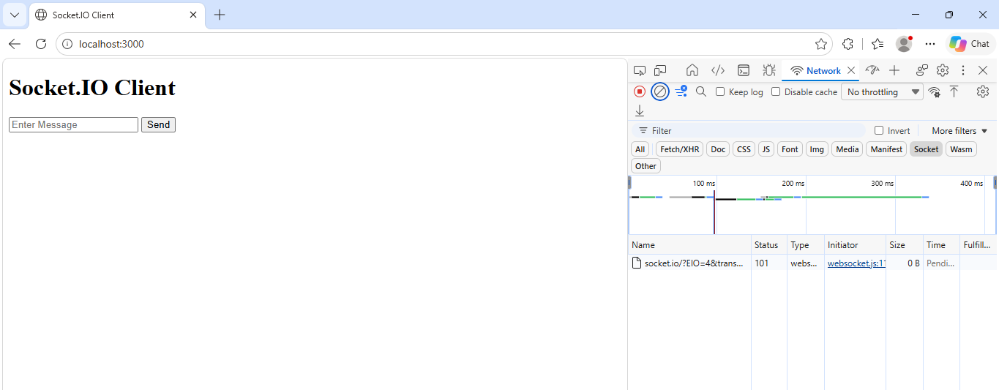
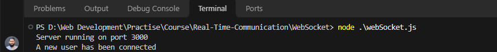
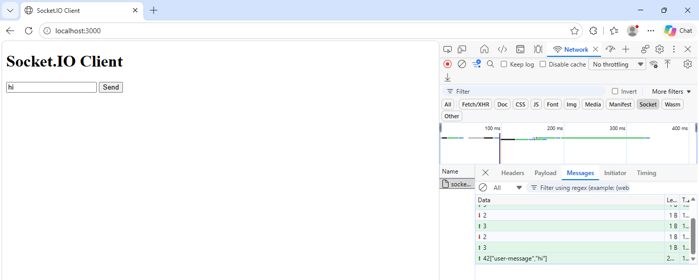
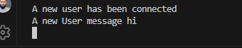
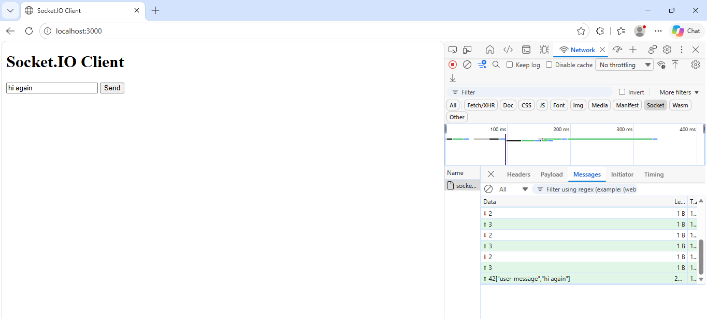
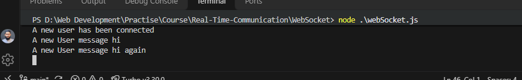

# Sending Messages with Socket.IO

## Overview

In this practice, I continued from the previous Socket.IO connection practice.

Previously, I created the Socket.IO connection only after clicking a button. In this practice, the client connection is created automatically when the browser loads or reloads the page because `const socket = io()` runs as soon as the HTML script executes.

After establishing the connection, I added an input field and a Send button. When the user clicks Send, the browser reads the input value and sends it to the Node.js server using a Socket.IO event.

**What this practice implements:**

- Automatically connecting the browser to the Socket.IO server when the page loads.
- Detecting the client connection on the server.
- Reading text from an HTML input field.
- Sending a message from the client to the server using `socket.emit()`.
- Receiving that event on the server using `socket.on()`.
- Printing the received message in the VS Code terminal.
- Observing the connection and message frames in Chrome DevTools.

**Important:** This practice uses one browser client and one server. The server receives and prints client messages. We have not yet implemented server-to-client replies, broadcasting, or a multi-user chat.

## Technologies Used

- Node.js
- Express
- Node.js HTTP module
- Socket.IO
- JavaScript
- HTML

## 1. Project Setup

If the project has not already been initialized:

```bash
npm init -y
```

Install Express and Socket.IO:

```bash
npm install express socket.io
```

The project uses ES modules, so `package.json` contains:

```json
"type": "module"
```

## 2. Project Structure

The existing folder structure is kept. No `public` folder is required.

```text
Real-Time-Communication/
│
├── node_modules/
└── WebSocket/
    ├── client1.html
    └── webSocket.js
```

For the commands and relative paths shown in this practice, open the terminal inside the `WebSocket` folder and run:

```bash
node .\webSocket.js
```

The server code below uses paths relative to that working directory.

## 3. Server Code — `webSocket.js`

### Step 1: Import the required packages

```js
import express from "express";
import http from "node:http";
import path from "node:path";
import { Server } from "socket.io";
```

**Explanation:**

- `express` gives us Express for handling HTTP routes and middleware.
- `node:http` is Node.js's built-in HTTP module. We use it to create the HTTP server.
- `node:path` provides utilities for resolving filesystem paths.
- `Server` is the Socket.IO server class.

### Step 2: Create the Express application

```js
const app = express();
```

This creates the Express application. We use `app` to register middleware and HTTP routes.

### Step 3: Create the HTTP server

```js
const server = http.createServer(app);
```

This creates a Node.js HTTP server and gives it the Express application.

The HTTP server receives HTTP requests. Express handles those requests. We create this server explicitly because Socket.IO will attach to the same server.

### Step 4: Attach Socket.IO to the HTTP server

```js
const io = new Server(server);
```

This creates the Socket.IO server and attaches it to our HTTP server. Both Express and Socket.IO can now use the same server and port.

### Step 5: Serve the HTML file

```js
app.use(express.static(path.resolve("./WebSocket")));

app.get("/", (req, res) => {
    return res.sendFile(path.resolve("client1.html"));
});
```

**Explanation:**

- `path.resolve(".")` resolves the current terminal working directory to an absolute path.
- `express.static(...)` registers middleware that can serve static files from that directory.
- `app.get("/")` handles a GET request for the homepage.
- `req` represents the incoming HTTP request.
- `res` is used to send a response.
- `res.sendFile(...)` sends `client1.html` to the browser.

In this setup, run the server while the terminal's current directory is the `WebSocket` folder. That is why `client1.html` resolves correctly.

### Step 6: Listen for a client connection and its messages

```js
io.on("connection", (socket) => {
    console.log("A new user has been connected");

    socket.on("user-message", (message) => {
        console.log("A new User message", message);
    });
});
```

**Explanation:**

- `io.on("connection", ...)` listens for a new Socket.IO client connection.
- When a client successfully connects, Socket.IO runs this callback.
- Socket.IO provides the callback with a `socket` object for that particular client's connection.
- `socket.on("user-message", ...)` listens for an event named `"user-message"` arriving from this client.
- When that event arrives, the callback receives its message data in the `message` parameter.
- `console.log()` prints the received message in the VS Code terminal.

**Important:** `socket` here represents the individual client's connection. It does not mean the client message itself.

### Step 7: Start the server

```js
server.listen(3000, () => {
    console.log("Server running on port 3000");
});
```

This starts the HTTP server on port `3000`. It can now serve the HTML page and accept Socket.IO connections.

## 4. Complete Server Code

**`webSocket.js`**

```js
import express from "express";
import http from "node:http";
import path from "node:path";
import { Server } from "socket.io";

const app = express();

const server = http.createServer(app);

const io = new Server(server);

// Serve static files from the current working directory.
// Run this file while the terminal is inside the WebSocket folder.
app.use(express.static(path.resolve(".")));

// Send client1.html when the browser requests the homepage.
app.get("/", (req, res) => {
    return res.sendFile(path.resolve("client1.html"));
});

// Handle a new client connection and messages from that client.
io.on("connection", (socket) => {
    console.log("A new user has been connected");

    // Listen for the "user-message" event from this client.
    socket.on("user-message", (message) => {
        console.log("A new User message", message);
    });
});

// Start the HTTP server.
server.listen(3000, () => {
    console.log("Server running on port 3000");
});
```

**Note about the connection handler:** Keep the `io.on("connection", ...)` handler in one place. In the code I was practicing, the connection event was registered twice. Combining the connection log and message listener into one handler makes the flow easier to follow and avoids duplicate connection handling code.

## 5. Client Code — `client1.html`

### Step 1: Create the input and button

```html
<h1>Socket.IO Client</h1>

<input type="text" id="message" placeholder="Enter Message">
<button id="sendBtn">Send</button>
```

- The input lets the user type a message.
- The `id="message"` lets JavaScript find the input element.
- The button has `id="sendBtn"` so JavaScript can listen for clicks.

### Step 2: Load the Socket.IO client library

```html
<script src="/socket.io/socket.io.js"></script>
```

Socket.IO serves its browser client library at this path. This script makes the `io()` function available in the browser.

### Step 3: Create the Socket.IO connection automatically

```js
const socket = io();
```

This line runs when the browser executes the script. It creates the Socket.IO client and starts connecting to the same origin that served the page.

**Difference from the previous practice:** Previously, I called `io()` inside a button-click function, so the connection started only after clicking that button. Now `io()` is at the top level of the script, so the connection starts automatically when the page loads or reloads.

### Step 4: Select the input and button elements

```js
const messageInput = document.getElementById("message");
const sendBtn = document.getElementById("sendBtn");
```

- `document.getElementById("message")` gets the input element.
- `document.getElementById("sendBtn")` gets the Send button.
- We store both elements in variables so we can use them in the click handler.

### Step 5: Listen for a click and read the input value

```js
sendBtn.addEventListener("click", (e) => {
    const message = messageInput.value;
    console.log(message);
});
```

- `addEventListener("click", ...)` runs the callback when the button is clicked.
- `messageInput.value` reads the text currently entered by the user.
- `console.log(message)` prints the value in the browser console.

This is a useful first test: it checks that the button click works and JavaScript can read the input.

### Step 6: Send the message to the server

Add this line inside the click handler:

```js
socket.emit("user-message", message);
```

- `socket.emit()` sends an event through the Socket.IO connection.
- `"user-message"` is the event name. The client and server must use the same event name.
- `message` is the data sent with the event.

The server listens for that same event with:

```js
socket.on("user-message", (message) => {
    console.log("A new User message", message);
});
```

The client uses `emit()` to send the event. The server uses `on()` to listen for it.

## 6. Complete Client Code

**`client1.html`**

```html
<!DOCTYPE html>
<html lang="en">

<head>
    <meta charset="UTF-8">
    <title>Socket.IO Client</title>
</head>

<body>

    <h1>Socket.IO Client</h1>

    <input type="text" id="message" placeholder="Enter Message">
    <button id="sendBtn">Send</button>

    <!-- Load the Socket.IO client library provided by the server. -->
    <script src="/socket.io/socket.io.js"></script>

    <script>
        // Step 1: Create the Socket.IO connection.
        // This runs automatically when the browser loads this page.
        const socket = io();

        // Step 2: Get the input and button elements from the HTML.
        const messageInput = document.getElementById("message");
        const sendBtn = document.getElementById("sendBtn");

        // Step 3: When the Send button is clicked, read the input value.
        sendBtn.addEventListener("click", (e) => {
            const message = messageInput.value;

            // Step 4: Print the message in the browser console for testing.
            console.log(message);

            // Step 5: Send the message to the server using a Socket.IO event.
            socket.emit("user-message", message);
        });
    </script>

</body>

</html>
```

## 7. What Happens When We Run the Project?

### A. Before starting the server

The terminal is open in the `WebSocket` folder, but the server has not started yet.



### B. Start the server

Run:

```bash
node .\webSocket.js
```

The server starts listening on port `3000`.



### C. Open the page before reloading or connecting

Open:

```text
http://localhost:3000
```

The HTML page is served by Express. In this practice, `io()` runs when the page's script executes, so loading the page starts the Socket.IO connection.



### D. Reload the page and observe the connection

When the page reloads, the browser executes `const socket = io()` again and starts a new Socket.IO connection.

The Network tab shows the Socket.IO WebSocket connection request.



### E. Server detects the connected client

When the connection succeeds, the server's `io.on("connection", ...)` callback runs.

The terminal prints:

```text
A new user has been connected
```



### F. Enter a message in the browser

Type a message into the input field. In this screenshot, the message is `hi`.



### G. Server receives the first message

Click Send. The client emits the `"user-message"` event with the input value. The server receives it and prints it in the terminal.

Expected terminal output:

```text
A new user has been connected
A new User message hi
```



### H. Send another message

Enter another message, such as `hi again`, and click Send again.



### I. Server receives the second message

The same connection can carry more messages. The server's message listener runs each time the client emits `"user-message"`.

Expected terminal output:

```text
A new user has been connected
A new User message hi
A new User message hi again
```



## 8. Understand the Communication Flow

```text
          CLIENT (Browser)                       SERVER (Node.js)
                 |                                      |
        Browser loads page                              |
                 |                                      |
        const socket = io()                             |
                 |                                      |
        Socket.IO starts connection ------------------->|
                 |                           io.on("connection")
                 |                           callback executes
                 |                                      |
        User types a message                             |
                 |                                      |
        User clicks Send                                |
                 |                                      |
        socket.emit(                                    |
          "user-message", message                       |
        ) --------------------------------------------->|
                                          socket.on("user-message")
                                          receives the message
                                                     |
                                          console.log(message)
                                                     |
                                          Message appears in
                                          VS Code terminal
```

## 9. Important Concepts Learned

| Concept | Meaning |
|---|---|
| `io()` | Creates a Socket.IO client and starts connecting to the server |
| `io.on("connection", ...)` | Server-side event that runs when a client connects |
| `socket` | Represents one individual Socket.IO client connection on the server |
| `document.getElementById()` | Finds an HTML element using its ID |
| `addEventListener("click", ...)` | Runs a callback when the button is clicked |
| `.value` | Reads the current value of an input element |
| `socket.emit()` | Sends a named event and its data |
| `socket.on()` | Listens for a named event |
| `"user-message"` | The custom event name used by both client and server |
| `console.log()` | Prints information in the browser console or server terminal, depending on where it runs |

## 10. Previous Practice vs. This Practice

| Previous practice | This practice |
|---|---|
| Connection started after clicking a button | Connection starts automatically when the page loads |
| Focused on establishing the connection | Focused on sending a client message to the server |
| Detected the client connection | Detected the connection and received messages |
| No message event was implemented | Added the `"user-message"` event |

## Project Status

**Completed:**

- Created an Express application and HTTP server.
- Attached Socket.IO to the HTTP server.
- Served the client HTML page through Express.
- Created the Socket.IO client automatically when the page loads.
- Detected the client connection on the server.
- Read text from an HTML input.
- Sent messages from the browser to the server using `emit()`.
- Received messages on the server using `on()`.
- Printed received messages in the VS Code terminal.
- Sent multiple messages through the same client connection.

**Not implemented yet:**

- Sending a response from the server back to the client.
- Connecting multiple users.
- Sending a message to a specific connected user.
- Broadcasting a message to all connected users.
- Building a complete chat interface.

## Next Practice: Connecting Multiple Users

In the next practice, I will learn how multiple browser clients can connect to one Socket.IO server.

Topics to explore:

- Opening multiple browser clients.
- Understanding that each connected client has its own `socket` object and socket ID.
- Detecting when different users connect.
- Tracking the number of connected users.
- Sending messages to a specific client.
- Broadcasting messages to all connected clients.
- Detecting when a client disconnects.

**Next Repository:** [Connecting Multiple Users with Socket.IO](https://github.com/MuhammadMusabYaqoob/3-WebSocket-Multiple-Users)
